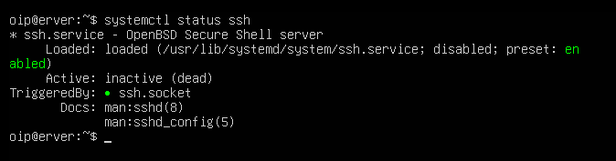
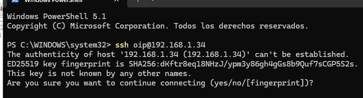
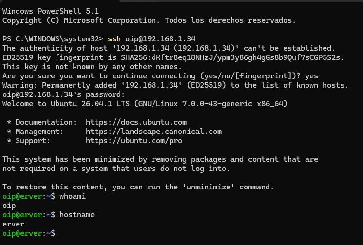

# Guía de instalación y configuración de SSH en Ubuntu Server

Esta guía explica cómo **instalar un servidor SSH** en Ubuntu Server y cómo **conectarse a él desde Windows**. La he escrito a partir de la práctica que hice en mi propio laboratorio: una máquina virtual con Ubuntu Server en *VMware Workstation*, administrada desde la PowerShell de mi PC con Windows. Todas las capturas y direcciones son reales.

## Índice

- [1. Introducción](#1-introducción)
- [2. Mi laboratorio y requisitos previos](#2-mi-laboratorio-y-requisitos-previos)
- [3. Procedimiento](#3-procedimiento)
  - [3.1 Preparar la red de la máquina virtual](#31-preparar-la-red-de-la-máquina-virtual)
  - [3.2 Instalar el servidor OpenSSH](#32-instalar-el-servidor-openssh)
  - [3.3 Comprobar y activar el servicio](#33-comprobar-y-activar-el-servicio)
  - [3.4 Averiguar la IP del servidor](#34-averiguar-la-ip-del-servidor)
  - [3.5 Conectarse desde Windows](#35-conectarse-desde-windows)
- [4. Comprobación](#4-comprobación)
- [5. Resolución de problemas](#5-resolución-de-problemas)
- [6. Referencias](#6-referencias)

---

## 1. Introducción

**SSH** (*Secure Shell*) es un protocolo para administrar un equipo a distancia a través de la red. Todo lo que viaja entre el cliente y el servidor (usuario, contraseña y comandos) va **cifrado**. Por eso sustituye a protocolos antiguos como *Telnet*, que enviaban la información en texto plano.

El servidor SSH escucha por defecto en el **puerto 22/TCP**. En Ubuntu, el programa servidor se llama `sshd` y viene en el paquete `openssh-server`.

---

## 2. Mi laboratorio y requisitos previos

| Elemento | Mi equipo | Para qué lo uso |
|---|---|---|
| Virtualizador | VMware Workstation | Crear la máquina virtual |
| Servidor | Ubuntu Server 26.04.1 LTS, 6 GB de RAM, 2 CPU, disco de 20 GB | Equipo al que me conecto |
| Nombre y usuario del servidor | `erver` / `oip` | Datos para iniciar sesión |
| IP del servidor | `192.168.1.34/24` (por DHCP, interfaz `ens33`) | Dirección a la que me conecto |
| Cliente | Windows con PowerShell 5.1 | Equipo desde el que administro |

Para repetir la práctica necesitas:

- Una máquina virtual con **Ubuntu Server** instalado.
- Un usuario con permisos de administrador (`sudo`).
- Conexión a Internet en la máquina virtual para descargar paquetes.
- Un equipo Windows o Linux en la misma red, que hará de cliente.

> **Aviso:** la tarjeta de red de la máquina virtual tiene que estar en modo **puente** (*bridged*). Si se deja en *NAT*, la máquina recibe una IP de una red interna de VMware y es más difícil llegar a ella desde otros equipos.

---

## 3. Procedimiento

### 3.1 Preparar la red de la máquina virtual

1. En VMware Workstation, abre la **Configuración de máquina virtual**.
2. Selecciona **Adaptador de red** y marca **Conexión en puente: conectado directamente a la red física**.
3. Durante la instalación de Ubuntu Server, en la pantalla *Network configuration*, comprueba que la interfaz `ens33` recibe una IP por DHCP de tu red. En mi caso fue `192.168.1.34/24`.


### 3.2 Instalar el servidor OpenSSH

Con tu usuario normal (no como *root*), actualiza la lista de paquetes e instala el servidor:

```bash
sudo apt update
sudo apt install openssh-server
```

Además de `openssh-server`, se instalan dos dependencias: `libwrap0` y `openssh-sftp-server`. Esta última permite también copiar archivos de forma segura con **SFTP**.


### 3.3 Comprobar y activar el servicio

Comprueba el estado con `systemctl status ssh`. Al hacerlo nada más instalar, a mí me apareció así:



Parece un error, pero no lo es. En las versiones recientes de Ubuntu, SSH se arranca **por socket**: la línea `TriggeredBy: ssh.socket` indica que `ssh.socket` vigila el puerto 22 y arranca el servicio en cuanto llega una conexión.

Para que el servicio quede siempre en marcha y se inicie con el sistema:

```bash
sudo systemctl enable --now ssh
systemctl status ssh
```

Ahora el estado es `active (running)` y el registro muestra que `sshd` escucha en el puerto 22, tanto en IPv4 (`0.0.0.0`) como en IPv6 (`::`).


### 3.4 Averiguar la IP del servidor

Para conectarte necesitas la IP del servidor. Obtenla con `ip a` y busca la línea `inet` de la interfaz de red (no la de `lo`, que es la interfaz local):


En mi caso, la interfaz `ens33` tiene la IP **192.168.1.34** con máscara `/24`.

### 3.5 Conectarse desde Windows

Windows 10 y 11 ya traen el cliente SSH, así que no hace falta instalar nada.

1. Abre **PowerShell**.
2. Escribe `ssh` seguido de tu usuario del servidor, una arroba y la IP:

```powershell
ssh oip@192.168.1.34
```

3. La primera vez, el cliente no conoce al servidor y enseña su **huella digital** (*fingerprint*). Escribe `yes` para aceptarla:



4. El cliente guarda la huella en el archivo `known_hosts`. Así, las siguientes veces comprobará que el servidor es el mismo y avisará si cambia.
5. Escribe la contraseña de tu usuario. Mientras la escribes no aparece nada en pantalla, y es normal.

---

## 4. Comprobación

Si la conexión funciona, verás el mensaje de bienvenida de Ubuntu y el *prompt* cambiará al del servidor (`oip@erver:~$`). Para confirmar dónde estás conectado:

```bash
whoami
hostname
```



Para cerrar la sesión remota y volver a PowerShell, escribe `exit`.

---

## 5. Resolución de problemas

Estos son los problemas que me encontré al hacer la práctica, y otros habituales:

| Problema | Causa | Solución |
|---|---|---|
| Instalé el paquete como *root* con `sudo su` | Trabajar como *root* no es buena práctica y me despisté | Desinstalé con `sudo apt purge openssh-server`, salí de *root* con `exit` y lo repetí con mi usuario y `sudo` |
| El nombre del servidor sale como `erver` | Errata al escribir el nombre durante la instalación | No afecta a SSH. Se puede cambiar con `sudo hostnamectl set-hostname server` |
| `systemctl status ssh` dice `inactive (dead)` | Ubuntu arranca SSH por socket (`ssh.socket`) | No es un fallo. Con `sudo systemctl enable --now ssh` queda siempre activo |
| `Connection timed out` | IP equivocada o máquina virtual en NAT | Revisa la IP con `ip a` y pon la red en modo puente |
| `Connection refused` | El servidor SSH no está instalado o está parado | `sudo systemctl start ssh` |
| `Permission denied` | Usuario o contraseña incorrectos | Comprueba el usuario (`oip` en mi caso) y vuelve a escribir la contraseña |

> **Nota:** abrí PowerShell como administrador, pero para usar `ssh` no hace falta. Basta con abrirlo normal.

---

## 6. Referencias

- [Documentación de Ubuntu Server sobre OpenSSH](https://ubuntu.com/server/docs/openssh-server)
- [Página del proyecto OpenSSH](https://www.openssh.com/)
- [Cliente OpenSSH en Windows (Microsoft Learn)](https://learn.microsoft.com/es-es/windows-server/administration/openssh/openssh_overview)
